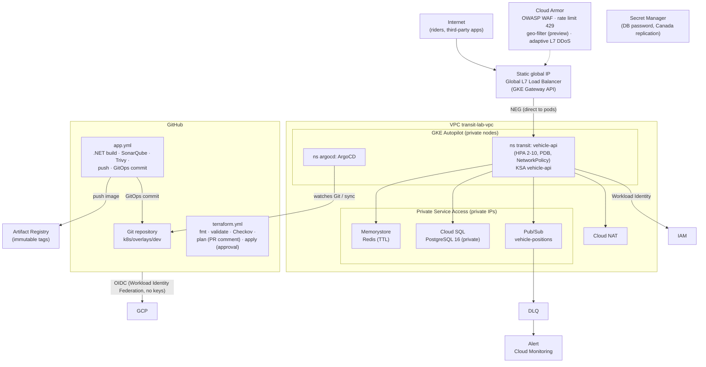

# Transit DevOps Lab: GKE Autopilot + ArgoCD + Cloud Armor on GCP

Use case: **real-time vehicle positions API** (inspired by GTFS-Realtime), deployed with GitOps on GKE Autopilot in Montreal (`northamerica-northeast1`), protected by Cloud Armor, with event-driven ingestion through Pub/Sub, a Redis cache and PostgreSQL reference data.

## Architecture



## Repository layout

| Folder | Role | GCS state (prefix) |
|---|---|---|
| `bootstrap/` | APIs, state bucket, GitHub WIF, CI service accounts | `bootstrap` (after migration) |
| `infra/` | VPC, NAT, GKE Autopilot, Cloud Armor, Artifact Registry, Pub/Sub, Redis, Cloud SQL, Secret Manager, Workload Identity IAM, alert | `infra` |
| `platform/` | Namespace, ConfigMap (infra outputs → k8s), ArgoCD, ArgoCD Application | `platform` |
| `k8s/` | Kustomize manifests (Deployment, HPA, PDB, Gateway, HTTPRoute, GCPBackendPolicy, NetworkPolicy) | n/a (GitOps) |
| `app/` | Demo .NET 10 API + non-root Dockerfile | n/a |
| `.github/workflows/` | Terraform and application pipelines | n/a |
| `docs/` | Interview guide (Markdown + PDF) and `tools/build-pdf.sh` to regenerate the PDF | n/a |

The PDF in `docs/` is generated from `docs/INTERVIEW-GUIDE-ARTM.md`. After editing the Markdown, regenerate it with `docs/tools/build-pdf.sh` (requires `python3` and Google Chrome; set `CHROME=/path/to/chrome` if it is not found automatically).

Why three stacks? **Blast radius** (a mistake in the platform does not touch the network), **lifecycle** (bootstrap rarely changes), and a **technical constraint**: the `kubernetes`/`helm` providers need an existing cluster at plan time.

---

## Managing the state file in GCP

1. **Chicken-and-egg problem**: the bucket that will store the state does not exist yet. So `bootstrap` first runs with a **local** state, creates the bucket, and then its own state is **migrated** into the bucket (`terraform init -migrate-state`).
2. **Bucket** `<PROJECT_ID>-tfstate`:
   - uniform bucket-level access and `public_access_prevention = enforced`;
   - **versioning** enabled, which lets you restore a corrupted state;
   - lifecycle rules that keep 10 noncurrent versions, for at most 90 days;
   - Montreal region (the state contains secrets, such as the DB password).
3. **Locking**: native with the `gcs` backend (`.tflock` file), no external table. In CI, `concurrency: terraform-dev` also prevents two simultaneous runs.
4. **Separation**: one prefix per stack (`bootstrap`, `infra`, `platform`). The `platform` stack reads the `infra` outputs through `terraform_remote_state`.
5. **Access**: the `gh-terraform` account has `storage.objectAdmin` **on the bucket only**.
6. **Restoring a version**:
   ```bash
   gcloud storage ls -a gs://$PROJECT_ID-tfstate/infra/default.tfstate
   gcloud storage cp "gs://$PROJECT_ID-tfstate/infra/default.tfstate#<GENERATION>" \
                     gs://$PROJECT_ID-tfstate/infra/default.tfstate
   ```
7. **Orphaned lock** (interrupted run): `terraform force-unlock <LOCK_ID>`, only after confirming that no run is in progress.

---

## Step-by-step deployment

### 0. Prerequisites

- A **dedicated** GCP project with billing enabled, and the Owner role on that project (for the bootstrap only).
- Tools: `gcloud`, `terraform >= 1.9`, `kubectl`, `gke-gcloud-auth-plugin`, `gh` (GitHub CLI), `git`.
- A GitHub repository containing this code. **Public** for simplicity; otherwise see "Private repository" below.

```bash
export PROJECT_ID="my-transit-lab-project"
export REGION="northamerica-northeast1"
export GITHUB_REPO="my-account/transit-devops-lab"

gcloud auth login
gcloud auth application-default login
gcloud config set project "$PROJECT_ID"
```

Replace `REPLACE_PROJECT_ID` in `k8s/overlays/dev/kustomization.yaml`, then format the code:

```bash
sed -i "s/REPLACE_PROJECT_ID/$PROJECT_ID/" k8s/overlays/dev/kustomization.yaml
terraform fmt -recursive
```

### 1. Bootstrap (once, from your workstation)

```bash
cd bootstrap
terraform init
terraform apply -var="project_id=$PROJECT_ID" -var="github_repo=$GITHUB_REPO"

# Migrate the local state to the bucket
cp backend.tf.example backend.tf
terraform init -migrate-state -backend-config="bucket=${PROJECT_ID}-tfstate"
rm -f terraform.tfstate terraform.tfstate.backup   # after confirming the migration
cd ..
```

### 2. Configure GitHub

```bash
# Prints the commands to run (repository variables)
terraform -chdir=bootstrap output -raw github_variables_commands
# ... then run them (gh must be authenticated against the repository)

# "dev" environment with manual approval for applies
gh api -X PUT "repos/$GITHUB_REPO/environments/dev" \
  -F "reviewers[][type]=User" -F "reviewers[][id]=$(gh api user -q .id)"
```

Optional, for SonarQube/SonarCloud: the `SONAR_TOKEN` secret and the `SONAR_PROJECT_KEY`, `SONAR_ORG` and optionally `SONAR_HOST_URL` variables.

### 3. Infrastructure and platform

**Option A: through GitHub Actions (recommended)**

```bash
git add . && git commit -m "feat: transit lab" && git push origin main
```
The `terraform` workflow runs `infra` (plan, then approval in the Actions tab, then apply), then `platform`. Allow about 15 to 20 minutes (GKE and Cloud SQL take the longest).

**Option B: from your workstation**

```bash
cd infra
terraform init -backend-config="bucket=${PROJECT_ID}-tfstate"
terraform plan  -var-file=env/dev.tfvars -var="project_id=$PROJECT_ID" -out=tfplan
terraform apply tfplan
cd ../platform
terraform init -backend-config="bucket=${PROJECT_ID}-tfstate"
terraform apply -var-file=env/dev.tfvars -var="project_id=$PROJECT_ID" \
  -var="state_bucket=${PROJECT_ID}-tfstate" \
  -var="gitops_repo_url=https://github.com/${GITHUB_REPO}.git"
cd ..
```

### 4. Application

Any change in `app/` on `main` triggers `app.yml`, which chains: build, SonarQube, image, Trivy (blocking), push `vehicle-api:<sha>`, then a commit updating `k8s/overlays/dev`. ArgoCD detects that commit and deploys (in about 60 s).

First deployment: `gh workflow run app.yml`.

> If `main` is protected, the bot's `git push` fails. In that case, use a GitHub App or an automated promotion PR (best practice in production).

### 5. Checks

```bash
gcloud container clusters get-credentials transit-lab-gke --region $REGION --dns-endpoint
kubectl -n transit get pods,hpa,gateway,httproute
kubectl -n transit describe gateway transit-gateway   # wait for "Programmed=True" (~5 min)

# ArgoCD
kubectl -n argocd get secret argocd-initial-admin-secret -o jsonpath='{.data.password}' | base64 -d; echo
kubectl -n argocd port-forward svc/argocd-server 8080:80   # http://localhost:8080 (admin)

IP=$(terraform -chdir=infra output -raw gateway_ip)
curl -s http://$IP/api/v1/vehicles | jq .          # 1st call "origin", then served from the 10 s cache

# Pub/Sub
curl -s -X POST http://$IP/api/v1/vehicles/positions -H 'Content-Type: application/json' \
  -d '{"vehicleId":"BUS-101","routeId":"55","lat":45.51,"lon":-73.56,"timestamp":"2026-11-21T08:00:00Z"}'
gcloud pubsub subscriptions pull vehicle-positions-processor --auto-ack --limit=5
```

### 6. Demonstrating Cloud Armor

```bash
# WAF: SQL injection → 403
curl -s -o /dev/null -w "%{http_code}\n" "http://$IP/api/v1/vehicles?id=1'%20OR%20'1'='1"

# Rate limiting: above 300 req/min → 429
for i in $(seq 1 400); do curl -s -o /dev/null -w "%{http_code}\n" http://$IP/api/v1/vehicles; done | sort | uniq -c

# Cloud Armor logs
gcloud logging read 'resource.type="http_load_balancer" AND jsonPayload.enforcedSecurityPolicy.outcome="DENY"' --limit=10 --format=json
```

### 7. Demonstrating GitOps (self-healing)

```bash
kubectl -n transit scale deploy vehicle-api --replicas=0   # manual drift
kubectl -n transit get deploy vehicle-api -w               # ArgoCD (selfHeal) restores the state from Git
```

Rollback: `git revert` the `deploy(dev): ...` commit, and ArgoCD goes back to the previous image.

### 8. Costs and teardown

Rough order of magnitude for a lab running continuously: GKE Autopilot (cluster fee and pods), Load Balancer, Cloud SQL `db-f1-micro`, 1 GB Redis and NAT. Expect a few dollars per day. Set `enable_cloudsql=false` and `enable_redis=false` to lower the bill, and **destroy after use**:

```bash
terraform -chdir=platform destroy -var-file=env/dev.tfvars -var="project_id=$PROJECT_ID" \
  -var="state_bucket=${PROJECT_ID}-tfstate" -var="gitops_repo_url=https://github.com/${GITHUB_REPO}.git"
kubectl -n transit delete gateway transit-gateway --ignore-not-found   # releases the LB before the VPC
terraform -chdir=infra destroy -var-file=env/dev.tfvars -var="project_id=$PROJECT_ID"
# Bootstrap: keep it (reusable) or destroy it. Note: a deleted WIF pool
# keeps its ID reserved for 30 days.
```

Also set up a **budget with alerts** (Billing > Budgets) before you start.

---

## Private repository

ArgoCD needs credentials. Create a read-only deploy key, then:
```bash
kubectl -n argocd create secret generic repo-gitops \
  --from-literal=type=git --from-literal=url=git@github.com:$GITHUB_REPO.git \
  --from-file=sshPrivateKey=./deploy_key
kubectl -n argocd label secret repo-gitops argocd.argoproj.io/secret-type=repository
```
And switch `gitops_repo_url` to SSH. In production, the secret comes from Secret Manager through External Secrets Operator.

## Known limitations and improvement ideas (good interview topics)

| Lab limitation | In production |
|---|---|
| HTTP only | Certificate Manager + Cloud DNS, HTTPS listener, 80→443 redirect, HSTS |
| ArgoCD via port-forward, admin account | OIDC SSO, per-team RBAC, AppProjects, exposure through IAP |
| The Terraform plan (CI artifact) contains the DB password | Password generated outside Terraform (Secret Manager rotation) or IAM DB auth; artifact encryption |
| Single environment | `env/dev`, `env/qa`, `env/prod`, separate projects, promotion by PR |
| GitHub Actions referenced by tag | Pin by SHA (supply-chain protection) + Dependabot |
| No image signing | cosign + Binary Authorization (only CI-signed images run) |
| Redis BASIC, Cloud SQL ZONAL | Redis STANDARD_HA, Cloud SQL REGIONAL + read replica |
| No API management gateway | Apigee in front of the API: developer keys, per-product quotas, open data portal |
| No canary | Argo Rollouts with automated metric analysis |
| No External Secrets | External Secrets Operator + Secret Manager (instead of the ConfigMap for secrets) |
| Helm chart versions not pinned | Pinning + Renovate |
