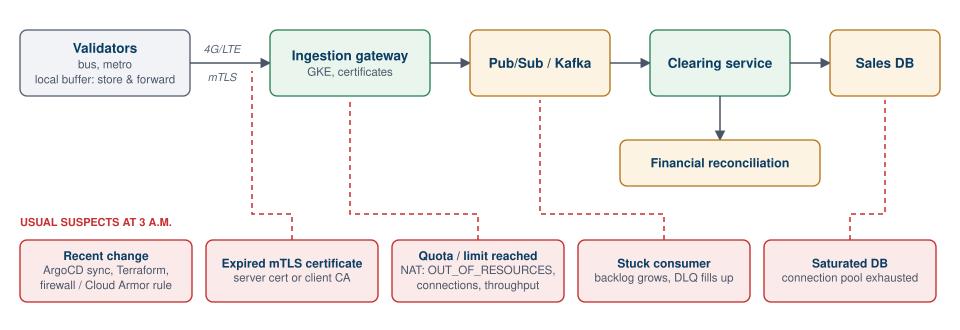

# Interview guide: Senior DevOps, ARTM

**Part 1**: technical questions with detailed answers.
**Part 2**: case studies with detailed architecture.
**Part 3**: GCP lab (D-7 to D-5). The code is in this repository; see `README.md`.

Delivery tip for each technical answer: **short definition → how I did it → trade-offs → a number or an anecdote**. Senior panels mostly assess how well you justify trade-offs.

---

# PART 1: Technical questions and detailed answers

## 1.1 Kubernetes

**Q1. Deployment, StatefulSet, DaemonSet, Job: when to use which?**
- **Deployment**: stateless workloads (APIs, front ends). Pods are interchangeable, updates are progressive and rollback happens through the ReplicaSet.
- **StatefulSet**: stable identity (names `pod-0`, `pod-1`), persistent volume **per pod** (volumeClaimTemplates), ordered startup and shutdown. For Kafka, Zookeeper, Elasticsearch or a self-hosted database.
- **DaemonSet**: one pod per node, for log, monitoring or security agents. Note: on Autopilot, DaemonSets are limited to authorized partners; Google manages the agents.
- **Job / CronJob**: one-off or scheduled processing, for example the nightly import of a static GTFS feed or a schema migration.
- My position: *"I prefer to keep databases as a managed service (Cloud SQL) rather than in a StatefulSet, unless there is a strong constraint. Operating a database in K8s is expensive in skills and on-call."*

**Q2. Explain requests, limits and QoS classes.**
- `requests`: what the scheduler reserves; it is also the basis for HPA calculations (CPU percentage). `limits`: the ceiling. Above the **memory** limit, the pod is killed (OOMKilled); above the **CPU** limit, it is only slowed down (throttling).
- QoS classes: **Guaranteed** (requests = limits on all containers), **Burstable** (requests < limits), **BestEffort** (no values). Under memory pressure on the node, eviction starts with BestEffort.
- Good practice: set the memory limit equal to the request (predictable behaviour) and **no CPU limit** (or a generous one) to avoid throttling runtimes like .NET or Java. On **Autopilot**, billing is based on requests, so tuning them has a direct financial impact.
- For Java: `-XX:MaxRAMPercentage=75`, so the JVM respects the container limit.

**Q3. How do you deploy with zero downtime?**
1. `maxUnavailable: 0` and `maxSurge: 1`.
2. A correct **readinessProbe**: the pod only receives traffic once ready (DB and cache connections established).
3. **Graceful shutdown**: the application handles SIGTERM, finishes in-flight requests and flushes its buffers (Pub/Sub, for example). Add a `preStop` (5 to 10 s sleep) to give the load balancer time to remove the pod, and a sufficient `terminationGracePeriodSeconds`.
4. A **PodDisruptionBudget**, to protect the service during node upgrades.
5. **Backward-compatible** DB migrations (expand/contract pattern, see 1.7).
6. Beyond that: blue/green or canary with Argo Rollouts (see Q4).

**Q4. Rolling, blue/green, canary: what are the differences?**
| Strategy | Principle | Advantage | Drawback |
|---|---|---|---|
| Rolling | progressive replacement of pods | simple, native | both versions coexist; slow rollback |
| Blue/green | two complete environments, traffic switch | instant rollback | double capacity during the switch |
| Canary | small percentage of traffic on the new version, then increase | minimal risk, metric-based decision | requires tooling (Argo Rollouts, mesh, weighted LB) |
- With **Argo Rollouts**, a 10% → 30% → 100% canary comes with an `AnalysisTemplate` that queries Prometheus or Cloud Monitoring (5xx error rate, p95 latency) and **automatically aborts** if a threshold is exceeded. With the GKE Gateway API, splitting is done with `weight` in the `HTTPRoute`.

**Q5. How do you secure a Kubernetes cluster?**
I answer layer by layer:
- **Access**: least-privilege RBAC, IAM or OIDC groups (no named users in RoleBindings), no day-to-day `cluster-admin`, audit logs enabled.
- **Control plane**: private endpoint or IAM-authenticated DNS endpoint, authorized networks.
- **Nodes**: private nodes, hardened OS (COS), automatic upgrades through a release channel, Shielded Nodes.
- **Pods**: Pod Security Standards at the `restricted` level (non-root, no privileges, seccomp, dropped capabilities), `readOnlyRootFilesystem`.
- **Network**: default-deny NetworkPolicies, east-west mTLS if a service mesh is present.
- **Identity**: Workload Identity, which means **no JSON service account keys** in the cluster.
- **Supply chain**: image scanning, signing (cosign), Binary Authorization or Kyverno to reject unsigned or non-compliant images.
- **Secrets**: Secret Manager through External Secrets or the CSI driver, etcd encryption with CMEK.
- **Policies**: Kyverno or OPA Gatekeeper (no `latest` tag, mandatory requests, ownership labels).

**Q6. A pod is in CrashLoopBackOff. What do you do?**
1. `kubectl describe pod`: events, exit code (`137` = OOMKilled or SIGKILL, `1` = application error), probe failures.
2. `kubectl logs <pod> --previous`: logs of the **previous** container, the one that crashed.
3. Common causes: missing environment variable or secret, overly aggressive liveness probe (the app is killed before it has started, hence the value of a startupProbe), OOM, unavailable dependency, wrong command or wrong `ENTRYPOINT`.
4. If nothing shows up: `kubectl debug` with an ephemeral container, or run the image locally with the same variables.
5. Was there a recent deployment? If so, **roll back first** (mitigate), then look for the cause.

Variants to know: **ImagePullBackOff** (non-existent tag, Artifact Registry permissions of the node SA, private IP without NAT or Private Google Access) and **Pending** (insufficient resources, nodeSelector or taints, unbound PVC; on Autopilot, provisioning takes one or two minutes, which is normal).

**Q7. HPA, VPA, Cluster Autoscaler: how do they interact?**
- **HPA**: adds pods based on CPU, memory or custom metrics (for example undelivered Pub/Sub messages, via external metrics).
- **VPA**: adjusts requests. Don't combine it with the HPA on the same CPU metric; use it in recommendation mode instead.
- **Cluster Autoscaler / Node Auto-Provisioning**: adds nodes when pods stay Pending. On **Autopilot**, this is fully managed.
- For ARTM: pre-scale (higher `minReplicas`) at rush hour or for known events (Grand Prix, festivals), using a CronJob or KEDA with a cron trigger. The HPA reacts in one to two minutes, which can be too slow for a sudden spike.

**Q8. GKE Autopilot or Standard?**
- **Autopilot**: Google manages the nodes, security is hardened by default, you pay per pod (requests) and the operational burden is low. Limits: no arbitrary DaemonSets or privileged pods, limited node access.
- **Standard**: full control (specific GPUs, kernel tuning, custom DaemonSets), but you manage node pools and upgrades yourself.
- For a team of 7 people handling many technologies, Autopilot reduces the on-call burden. I would choose it by default and switch to Standard for special needs.

## 1.2 Terraform / IaC

**Q9. How do you manage Terraform state?**
- **Remote backend**: versioned GCS bucket, uniform access, public access prevention, native locking. One **prefix per stack and per environment**.
- **Bootstrap**: the bucket is created with a local state, then migrated (`terraform init -migrate-state`).
- **Security**: the state contains secrets in plain text (generated passwords, for example). Access is restricted to the CI SA, with CMEK if needed. Avoid generating secrets in Terraform as much as possible.
- **Splitting**: several states rather than a monolith (network, cluster, platform, applications). Faster plans, smaller blast radius, separate permissions. Dependencies between stacks go through `terraform_remote_state` or, better, through data sources or a naming convention.
- **Incident**: restore a previous version thanks to GCS versioning; `force-unlock` only after checking that no run is in progress.

**Q10. How do you structure modules and environments?**
```
modules/            # versioned modules (git tag or private registry)
  gke-autopilot/  network/  cloudsql/
live/
  dev/  qa/  prod/  # module calls + tfvars; one state per folder
```
- **Small, composable** modules, with validated variables (`validation`), safe defaults and documented outputs.
- **Pinned versions** of modules and providers, plus a committed `.terraform.lock.hcl`.
- I prefer per-environment folders to workspaces: visibility, different permissions per environment, and prod in a separate project.
- To reduce repetition: Terragrunt, or Terraform Stacks in HCP Terraform.

**Q11. Someone changed a resource in the console. What happens?**
- On the next `plan`, Terraform detects the **drift** and proposes reverting to the state in the code. If the change was legitimate (emergency fix), it must be **carried over into the code**, otherwise it will be overwritten.
- Prevention: a nightly scheduled `plan` with `-detailed-exitcode` (code 2 = drift, alert), **read-only** console access in production, and a logged **break-glass** procedure (temporary elevation through PAM/JIT).
- If the resource was created by hand: an `import` block (Terraform 1.5+) with `-generate-config-out`, then clean up the code.
- The tone to adopt: blameless. Find out why the person had to use the console (tooling too slow, emergency) and fix the process.

**Q12. How do you refactor without destroying resources?**
- `moved { from = ..., to = ... }` blocks for a rename or a move into a module.
- Old-school `terraform state mv`, `removed {}` to take a resource out of Terraform management without deleting it.
- `lifecycle { prevent_destroy = true }` on critical resources (DBs, state buckets) and `deletion_protection` on the GCP side.
- Always read the plan: a `-/+ destroy and then create replacement` line on a DB should stop everyone.

**Q13. How do you secure and govern IaC in CI?**
- `fmt`, `validate`, `tflint`, **Checkov / tfsec / Trivy config** (public bucket, 0.0.0.0/0 firewall, missing encryption).
- **Policy-as-code**: OPA/Conftest on the plan JSON (`terraform show -json`), for example to forbid regions outside Canada or require cost labels.
- Plan commented on the PR, mandatory review, **apply of the exact approved plan** (saved plan file) and manual approval for production.
- **OIDC / Workload Identity Federation** authentication: no SA keys in GitHub secrets. A different SA per environment, least privilege.

**Q14. count or for_each?**
`for_each` over a map or a set: resources are identified by **key**, so removing one element does not shift the others. With `count`, removing element 0 from a list recreates all the following ones. Keep `count` for the boolean "create or not" case (`count = var.enable ? 1 : 0`).

## 1.3 CI/CD, GitOps, quality

**Q15. Push vs pull GitOps: difference and benefits?**
- **Push**: CI runs `kubectl apply` or `helm upgrade`. So CI needs cluster credentials, and drift is not corrected.
- **Pull (ArgoCD, Flux)**: an agent **inside** the cluster continuously compares the actual state with Git and reconciles.
  - Git becomes the **source of truth** and the audit trail (who deployed what, when, approved by whom).
  - **Self-healing** (`selfHeal`): a manual change is reverted.
  - **Rollback** = `git revert`.
  - **No cluster credentials in CI**: CI only pushes an image and a commit.
  - Disaster recovery: a new cluster is rebuilt from Git.
- Trade-offs: secrets management (Git must not contain them, hence External Secrets or Sealed Secrets), and a sync delay to account for (a Git webhook speeds it up).

**Q16. How do you structure repositories and promotion between environments?**
- **Application repository** (code and Dockerfile) separate from the **configuration repository** (manifests). This way, deployment commits don't trigger application CI and permissions are distinct.
- Kustomize `base/` + `overlays/{dev,qa,prod}`, or Helm charts with per-environment values.
- **The same image** (same digest) is promoted from one environment to the next. Never rebuild for prod.
- Promotion: in dev, automatic commit by CI; in QA and prod, a promotion **PR** (Kargo, or a script), approved by a person, then ArgoCD sync.
- **ApplicationSets**: generate ArgoCD applications per environment, per cluster or per directory.
- **AppProjects**: limit what a team can deploy (namespaces, source repositories, resource types).

**Q17. Describe a complete, secure CI/CD pipeline.**
1. **PR**: build, unit tests, **SonarQube** analysis (quality gate on *new code*: coverage ≥ 80%, 0 blocker bugs, 0 vulnerabilities), lint.
2. **SCA**: vulnerable dependencies (Dependabot, Snyk, OWASP Dependency-Check).
3. **Image build** (multi-stage, minimal base image, non-root), Trivy **scan** (blocking on CRITICAL), **SBOM** generation (Syft).
4. cosign **signing** (keyless OIDC) and SLSA **provenance attestation**.
5. **Push** to Artifact Registry with **immutable** tags (commit SHA).
6. **GitOps commit**, then ArgoCD sync in dev, then integration and smoke tests, then DAST (OWASP ZAP) in QA.
7. **Promotion** to prod by PR, canary deployment with automated analysis.
8. **Binary Authorization** on the cluster side: only CI-signed images run.
- GitHub Actions hygiene: actions pinned **by SHA**, minimal `permissions:` per workflow, OIDC instead of secrets, protected environments, CODEOWNERS.

**Q18. How do you introduce SonarQube in a team with technical debt?**
Don't block on existing code, or everyone will bypass the tool. Use the **"new code period"**: the quality gate only applies to changed code (boy-scout rule). Publish a debt dashboard and negotiate a percentage of capacity per sprint. The gate becomes blocking once the team agrees.

**Q19. How do you manage secrets in CI/CD and in Kubernetes?**
- CI: **OIDC** to the cloud (no long-lived keys), GitHub secrets scoped to an environment, nothing in the logs (masking).
- K8s: **External Secrets Operator** syncing Secret Manager into a K8s Secret, or the **Secret Manager CSI driver**. Rotation managed in Secret Manager, and pods reload (reloader).
- Never put secrets in Git, even base64-encoded. If needed: SOPS or Sealed Secrets.
- Detection: gitleaks or GitHub *secret scanning*, with push protection.

## 1.4 Cloud networking: WAF, DNS, DDoS

**Q20. Describe a request's path from the user to the pod on GCP.**
1. **DNS** (Cloud DNS): `api.example.ca` resolves to a **global anycast IP**.
2. **Google Front End** (nearest point of presence): TLS termination (Certificate Manager certificate), **native L3/L4 DDoS** protection (included).
3. **Cloud Armor**: L7 WAF, rate limiting, geo-filtering, adaptive protection (ML detection of L7 attacks).
4. **Cloud CDN** (optional) for cacheable responses.
5. Load balancer **URL map**, then backend service, then **NEG** (Network Endpoint Group) pointing **directly at pod IPs** (container-native load balancing, no kube-proxy hop).
6. LB health checks from `35.191.0.0/16` and `130.211.0.0/22`, to be allowed in firewall rules and NetworkPolicies.
7. Inside the cluster: pod, then internal ClusterIP calls, possibly a mesh.

**Q21. How do you configure a WAF without breaking the application?**
- Start in **preview mode** (Cloud Armor: `preview = true`). Rules log what they *would* have blocked. Analyse the logs for one to two weeks.
- Preconfigured OWASP rules (`sqli`, `xss`, `lfi`, `rce`, `scannerdetection`) at **sensitivity 1**, then increase. Exclude signatures that cause false positives (`opt_out_rule_ids`) on the affected paths.
- **Rate limiting** per IP, or per header or API key for partners: `throttle` (429) or `rate_based_ban` (temporary ban).
- High-priority **allowlist** for monitoring and known partners.
- **Adaptive protection**: it proposes rules during an L7 attack; apply them after validation, or automatically above a confidence threshold.
- **reCAPTCHA Enterprise** and bot management for sensitive flows (ticket purchase, login).
- The WAF replaces neither input validation nor parameterized queries in the code. It is defence in depth.

**Q22. How do you protect against a DDoS?**
- **L3/L4** (SYN flood, UDP amplification): absorbed by Google's infrastructure behind a global LB, with no configuration.
- **L7** (seemingly legitimate HTTP requests): Cloud Armor (rate limiting, adaptive protection, geo-filtering, bot management), CDN caching to offload the origin, autoscaling with a **ceiling** (so a DDoS doesn't turn into a bill, i.e. *Denial of Wallet*).
- **Hidden origin**: backends are only reachable through the LB (private nodes, firewall limited to Google ranges).
- **Cloud Armor Enterprise** (formerly Managed Protection Plus): Google's DDoS response team and cost protection.
- **Runbook**: detection (alerts on 4xx/5xx, RPS, latency), activation of predefined emergency rules (in preview, ready to enable), communication.

**Q23. What are the DNS pitfalls during a migration?**
- **Lower the TTL** (to 60 s, for example) **48 h before** the cutover, since the old TTL is still cached.
- Progressive cutover: weighted records (Cloud DNS *weighted round robin* routing policy) or at the LB level.
- Check the **certificates** for the new name (Certificate Manager DNS validation *before* the cutover).
- **DNSSEC**: be careful when changing DNS provider (DS records at the registrar).
- **Split-horizon**: a private zone and a public zone with the same name; internal and external resolution differ, which causes confusion when troubleshooting.
- Hybrid: DNS **forwarding** and **peering** between Cloud DNS and on-premises DNS (Active Directory).

**Q24. How do you connect GCP to on-premises systems or to operators (STM, exo…)?**
- **HA Cloud VPN** (IPsec, 99.99% SLA with two tunnels and BGP via Cloud Router) to start with.
- **Cloud Interconnect** (Dedicated or Partner) for throughput and latency.
- **Shared VPC**: a centrally managed network host project, service projects per team or application.
- **Private Service Connect**: expose or consume a service privately, without full VPC peering and without IP address conflicts. Ideal between organizations.
- A **coordinated** IP addressing plan from the start (RFC 1918 overlaps with partners are common).

## 1.5 API gateways

**Q25. What is an API gateway for, and which one to choose?**
Functions: authentication and authorization (OAuth2, JWT, API keys), **per-consumer quotas and rate limiting**, transformation (REST↔SOAP, headers), routing and versioning (`/v1`, `/v2`), caching, observability (analytics per API and per client), developer portal, monetization.

| Product | Positioning | When? |
|---|---|---|
| **Apigee** (Google) | Full API management: API products, developer portal, analytics, monetization, advanced policies | APIs exposed to **third parties** (open data, partners, operators), enterprise governance |
| **Kong** | Highly extensible open source and Enterprise gateway (plugins), can act as a K8s ingress | Multi-cloud or hybrid, plugin needs, controlled costs |
| **Traefik** | Cloud-native reverse proxy and ingress, dynamic configuration (CRDs) | Cluster ingress, simple routing, automatic discovery |
| **GCP API Gateway** | Lightweight managed gateway (OpenAPI) in front of Cloud Run or Functions | Simple cases, serverless |

Typical architecture: **Apigee for north-south** (external to internal systems: contracts, per-partner quotas) and **Gateway API, Traefik or Kong for cluster ingress** (internal routing). East-west traffic between microservices goes through a service mesh (Istio, Cloud Service Mesh) if needed.

**Q26. How do you version an API without breaking consumers?**
- Only **additive** changes within a version: add fields, never remove or rename them. Clients must ignore unknown fields (*tolerant reader*).
- Breaking change: `/v2` exposed in parallel, `/v1` marked **deprecated** (`Deprecation` and `Sunset` headers), schedule communicated, and per-client tracking of `/v1` usage in the gateway analytics before retirement.
- **OpenAPI contract** in Git, linted (Spectral) and tested (Pact contract tests) in CI.

**Q27. How does Apigee authenticate a partner?**
- The partner registers on the portal. A **developer app** is attached to an **API product** (a set of APIs, quotas and environments), which generates a client key and secret.
- Server-to-server call: OAuth2 *client credentials* (`OAuthV2` policy), then token and calls.
- Chained policies: `VerifyAPIKey` or `OAuthV2`, `SpikeArrest` (spike smoothing), `Quota` (per product or per app), `JSONThreatProtection`, then target and `ResponseCache`.
- Per-app analytics, and immediate revocation of a compromised key.

## 1.6 Software architecture: microservices, event-driven, streaming

**Q28. How do you split into microservices?**
- By **business domain** (DDD, *bounded contexts*): fares, sales, validation, rider information, customer account. Not by technical layer.
- **One database per service**: no joins across services, coupling through APIs or events.
- Signs of a bad split: mandatory synchronized deployments (distributed monolith), cascading synchronous calls, distributed transactions everywhere.
- I am pragmatic: starting with a **modular monolith** is often healthier. Extract a service when a scaling, team or lifecycle need justifies it.

**Q29. How do you handle a transaction that spans several services?**
- **Saga**: a sequence of local transactions, with **compensating actions** on failure (example: fare purchase → charge → fare issuance; if issuance fails, refund).
  - **Choreography**: each service reacts to events. Simple, but the overall flow is hard to follow.
  - **Orchestration**: an orchestrator drives the steps (GCP Workflows, Temporal, Camunda). More readable and traceable.
- **Transactional Outbox**: write the event to an `outbox` table **in the same transaction** as the business data; a relay (Debezium/CDC or a poller) then publishes it. This avoids the "DB updated but event lost" case.
- **Idempotency** on the consumer side (deduplication key), since delivery is *at-least-once*.

**Q30. At-least-once vs exactly-once delivery: what does it imply?**
- Most systems (Pub/Sub, Kafka by default) guarantee **at-least-once**: a message can be received twice (lost ack, timeout).
- So you need **idempotent** consumers: a stored `message_id` or business key (deduplication table, `INSERT ... ON CONFLICT DO NOTHING`), or naturally idempotent operations ("set the position to X" rather than "add 1").
- Pub/Sub offers an *exactly-once delivery* option (on pull subscriptions, within a region) and Kafka has transactions and idempotent producers. This costs latency and complexity, and does not exempt you from thinking about external side effects.
- **Ordering**: Pub/Sub guarantees ordering per `ordering_key` (for example `vehicle_id`), Kafka per partition. Global ordering is never guaranteed and rarely needed.
- **DLQ**: after N attempts, the message goes to dead-letter. Alert, analyse, fix, replay.

**Q31. Pub/Sub or Kafka?**
| | Pub/Sub | Kafka (Confluent, Managed Service for Apache Kafka) |
|---|---|---|
| Operations | serverless, no capacity to manage | partitions and brokers to size (even when managed) |
| Replay | seek or snapshot, retention up to 31 days | persistent log, native replay by offset, compaction |
| Ordering | per ordering key | per partition |
| Ecosystem | Dataflow, BigQuery subscriptions | Kafka Connect, Streams, ksqlDB, Schema Registry |
| Typical use | GCP event-driven integration, fan-out | high-throughput streaming, event sourcing, existing ecosystem |
For GTFS-RT positions on GCP: **Pub/Sub, then Dataflow** (windowing and enrichment), with BigQuery for analytics and Redis or Bigtable for the current state.

**Q32. Which resilience patterns do you implement?**
- **Timeouts** everywhere (never infinite), **retry with exponential backoff and jitter**, on idempotent operations only.
- **Circuit breaker**: cut calls to a failing dependency to let it recover (Polly in .NET, Resilience4j in Java).
- **Bulkhead**: isolate connection and thread pools per dependency.
- **Fallback and graceful degradation**: serve the last cached data with a "data from 2 min ago" indicator.
- **Rate limiting and load shedding**: reject early (429 or 503) rather than collapse.
- On .NET: `Microsoft.Extensions.Http.Resilience` (based on Polly v8), `AddStandardResilienceHandler()`. On Java: Resilience4j, or Spring Cloud Circuit Breaker.

**Q33. How do you instrument observability?**
- **Three signals**: metrics (Prometheus / Cloud Monitoring), **structured JSON** logs with `trace_id`, distributed traces (**OpenTelemetry** to Cloud Trace, Tempo or Jaeger).
- **Golden signals**: latency, traffic, errors, saturation. **RED** for services, **USE** for resources.
- **SLO**: for example 99.9% of `/vehicles` requests under 300 ms over 28 days. The **error budget** is used to arbitrate between velocity and stability.
- **Alert on symptoms** (SLO burn rate) rather than causes (CPU at 80%), to avoid alert fatigue on 24/7 on-call.
- Every alert links to a **runbook**.

## 1.7 Databases (SQL, NoSQL, cache)

**Q34. How do you choose between SQL, NoSQL and cache?**
| Need | GCP choice | ARTM example |
|---|---|---|
| ACID transactions, relations, integrity | Cloud SQL (PostgreSQL), AlloyDB | accounts, fares, sales |
| Global scale and strong consistency | Spanner | rarely needed at regional scale |
| Flexible documents, mobile | Firestore | app preferences |
| High-throughput time series | Bigtable | vehicle position history |
| Analytics | BigQuery | ridership, punctuality |
| Millisecond latency, ephemeral data | Memorystore (Redis/Valkey) | latest position, sessions, rate limiting |

**Q35. Which caching patterns do you know, and their pitfalls?**
- **Cache-aside** (the most common): read from the cache; on a miss, read from the DB and write to the cache with a TTL. The application stays in control.
- **Write-through**: write to the cache and the DB at the same time (strong consistency, slower writes). **Write-behind**: write to the cache, the DB is updated asynchronously (risk of loss).
- Pitfalls:
  - **Cache stampede** (*thundering herd*): the key expires and 1,000 requests hit the DB. Solutions: lock or *single flight*, early refresh, TTL with jitter.
  - **Invalidation**: short TTL for volatile data, event-driven invalidation for reference data.
  - **Cold cache** after a restart: warm-up.
  - **Redis is not a DB**: Memorystore BASIC has no replication, so STANDARD_HA in production.

**Q36. How do you migrate a schema with zero downtime?**
**Expand/contract** pattern (renaming `name` to `full_name`, for example):
1. **Expand**: add `full_name` (nullable); v1 ignores it.
2. Deploy v2, which **writes to both columns** and reads `full_name` with a fallback to `name`.
3. **Backfill** in batches (no long lock).
4. Deploy v3, which reads and writes only `full_name`.
5. **Contract**: drop `name` in a later release.
- Tools: Flyway or Liquibase (Java), EF Core Migrations (.NET), run **as a Job** (or an ArgoCD `PreSync` hook) before the deployment, never at the startup of each pod (concurrency).
- PostgreSQL: `CREATE INDEX CONCURRENTLY`. Watch out for `ALTER TABLE ... ADD COLUMN ... DEFAULT` on older versions and for `ACCESS EXCLUSIVE` locks.

**Q37. How do you ensure high availability and recovery for a DB?**
- **RPO** (tolerable data loss) and **RTO** (recovery time) are defined **with the business**, not by the technology.
- Cloud SQL **REGIONAL**: synchronous standby instance in another zone, automatic failover in about one minute.
- **Automatic backups and PITR** (transaction logs), **cross-region** read replica for disaster recovery (manual promotion).
- Regular **restore tests** (a backup that has never been restored is not a backup).
- Connection pooling (PgBouncer, or managed pooling): scaling pods quickly exhaust `max_connections`.

## 1.8 SaaS integration and IAM / CIAM

**Q38. How do you integrate a SaaS robustly?**
- **Exchange mode**: REST API with webhooks (event-driven, preferred) or polling (simple, but latency and quotas). For volume: SFTP, files or bulk API.
- **Inbound webhooks**: verify the HMAC signature, respond **quickly** (202) and process asynchronously (queue in Pub/Sub), idempotent consumer (the SaaS retries).
- **Outbound calls**: respect **quotas** (client-side rate limiting, backoff on 429), circuit breaker, secrets in Secret Manager with rotation.
- **Identity**: **SAML or OIDC** SSO with the corporate IdP, **SCIM** provisioning (automatic account creation and deactivation for joiners and leavers).
- **Governance**: contract and SLA, data residency (Quebec Law 25: privacy impact assessment before communicating personal information outside Quebec), exit plan (data export).
- **Anti-corruption layer**: an integration service translates the SaaS model into the internal model, which makes it possible to change vendors without rewriting everything.
- **iPaaS** (MuleSoft, Boomi, GCP Application Integration) if integrations multiply.

**Q39. IAM and CIAM: what is the difference, and how do you set up a CIAM?**
- **IAM (workforce)**: employees and contractors. SSO (Entra ID, Google Workspace), mandatory MFA, RBAC, access reviews, JIT access. Scale: thousands of users.
- **CIAM**: **riders** (customers). Self-registration, social login, **smooth experience**, adaptive MFA, consent and privacy, **scale of millions**, resistance to credential stuffing.
- Options: Identity Platform (GCP), Auth0 / Okta CIC, Entra External ID, Keycloak (self-hosted, more control but more operations).
- **Flows**: mobile app or SPA with **OIDC Authorization Code + PKCE** (never the implicit flow); APIs with **JWT** validation (signature via JWKS, `iss`, `aud`, `exp`) at the gateway; short-lived access tokens (5 to 15 min) and refresh tokens with rotation.
- **Security**: bot and credential-stuffing detection, risk-based adaptive MFA, protection against account enumeration, passkeys (WebAuthn).
- **Law 25**: explicit and granular consent, rights of access, rectification and erasure, data minimization, access logging, data residency in Canada where possible.
- **Migrating existing accounts**: *lazy migration* (on first login, verify against the old system, then create in the new one) or hash import (if the algorithm is supported, such as bcrypt or scrypt).

## 1.9 "Senior" questions on management and strategy

**Q40. How do you do a cost/benefit analysis of a solution?**
- **Costs**: licences, infrastructure (reserved instances, CUDs), **operational effort** (in full-time equivalents, often the most underestimated item), training, migration, exit.
- **Benefits**: delivery time (DORA: deployment frequency, lead time for changes, change failure rate, time to restore), incidents avoided, compliance, rider satisfaction.
- **Options compared**: *build*, *buy*, managed, open source, with a weighted matrix (3-year cost, risk, fit, in-house skills, vendor lock-in).
- **Risks**: probability × impact, mitigations, the risk of **doing nothing**.
- Deliverable: one page for leadership (recommendation, cost, benefit, risk) and a technical appendix.

**Q41. How do you work with a managed services provider?**
- A clear **RACI matrix** (who patches, who monitors, who gets woken up at 3 a.m.), SLAs and SLOs that are **measured** (not declared), penalties.
- **Shared IaC**: the provider works through PRs in ARTM's repositories, which avoids a black box and dependency.
- Least-privilege, **logged** access, quarterly reviews, shared runbooks, joint post-mortems.
- Knowledge must stay **in-house**: ARTM must be able to change providers.

**Q42. How do you explain a technical topic to senior leadership?**
Talk about **risk, cost, timelines and rider impact**, not technology. Example for GitOps: *"Today, a production release takes two days and a risky manual intervention. With this approach, every change is traced, approved and reversible in 5 minutes. We reduce the risk of outages during deployments and deliver features to riders faster."*

---

# PART 2: Case studies and detailed architectures

Answer framework for each case, at the whiteboard:
1. **Clarify**: volumes, SLOs, constraints (security, budget, timelines, compliance).
2. **Architecture**: layered diagram.
3. **Flows**: happy path, then error path.
4. **Choices and trade-offs**.
5. **Operations**: observability, on-call, runbooks.
6. **Costs and risks**.
7. **Progressive rollout**: MVP, then target state.

---

## Case 1: Load spike on the real-time API (metro outage)

**Scenario**: a major metro outage multiplies traffic on the real-time schedule API by 20; latency explodes.

### Target architecture


**Key idea**: separate the **write path** (streaming ingestion) from the **read path** (CQRS). The read API **never** queries the transactional DB directly; it reads a precomputed state from Redis, and the CDN absorbs most of the traffic.

### Incident response (short term)
1. **Diagnose** (5 min): golden-signal dashboards. Where is the bottleneck? (pod CPU, DB connections, Redis, upstream latency)
2. **Mitigate**:
   - raise the HPA `minReplicas` or `maxReplicas` (via a GitOps commit, or `kubectl` in an emergency and then carried over into Git);
   - enable or lengthen the **CDN TTL** (15-second-old data is still acceptable for riders);
   - stricter **rate limiting** for third-party clients (Apigee), prioritizing the Chrono app;
   - **graceful degradation**: disable expensive features (alternative route calculation) with a feature flag and serve the last snapshot with a timestamp.
3. **Communicate**: incident channel, updates every 30 minutes to leadership and customer service.

### Long term
- **Load tests** (k6, Gatling) in CI at 20 times the nominal load, and chaos days (*game days*).
- **SLOs** and burn-rate alerts.
- **Predictive** scaling: CronJob or KEDA (cron) at rush hour, and scaling on an external metric (LB RPS).
- Cost ceilings: realistic `maxReplicas` and a budget alert.
- **Blameless post-mortem**: timeline, root cause, actions with owners and dates.

**Trade-offs to state out loud**: freshness vs availability (the CDN TTL), cost of over-provisioning vs risk, client prioritization (the official app first).

---

## Case 2: Full pipeline for a new .NET microservice

### Pipeline architecture


### Details
- **Repository template** (*golden path*): the platform team provides a template (Backstage, or a template repository) containing the reusable workflow, Dockerfile, chart and dashboards. A new service starts in one hour with the standards built in: this is the **reuse of proven solutions** asked for in the job posting.
- **Reusable workflows** (`workflow_call`) in a central `.github` repository: a fix propagates to all services.
- **Secrets**: External Secrets Operator syncs Secret Manager into a K8s Secret. The application reads environment variables; it has no knowledge of GCP.
- **Database**: EF Core migrations in a dedicated image, run as a **Job** (ArgoCD `PreSync` hook), following the expand/contract pattern.
- **Observability by default**: OpenTelemetry .NET (traces and metrics), JSON logs, dashboard and SLOs generated from the template.
- **DORA metrics**: frequency, lead time, failure rate and MTTR, collected from GitHub and ArgoCD.

---

## Case 3: DDoS or bot attack on online fare sales

### Defence-in-depth architecture


### Incident runbook
1. **Detection**: alerts on RPS, 4xx/5xx rate, latency and adaptive protection (attack alert with a proposed rule).
2. **Qualification**: volumetric or application-level? Which signatures (user agent, ASN, country, paths)? Analyse Cloud Armor logs in BigQuery.
3. **Mitigation**: apply the rule proposed by adaptive protection, or a **predefined** emergency rule (already written and tested in preview); lower the rate-limit threshold and require reCAPTCHA on the attacked path.
4. **Protecting the experience**: virtual waiting room for purchases if capacity is reached, and a clear message to riders.
5. **Communication**: leadership, information security, vendor (Google support / Cloud Armor Enterprise).
6. **After the incident**: post-mortem, new permanent rules, load and simulated-attack testing (tabletop exercise).

**Compliance points**: PCI DSS (tokenization, network segmentation, logging), Law 25 (privacy incident to report to the CAI if there is a risk of serious injury), logs retained according to policy.

---

## Case 4: Industrializing a vendor-delivered software package

**Scenario**: an integrator delivers a solution on a hand-installed VM, with a 40-page Word document.

### Approach
1. **Assess**: stateful or stateless? Dependencies (DB, file share, licences tied to the MAC address or host)? Vendor support for containers? Release frequency?
2. **Negotiate deliverables** (contract clauses for future contracts): container images or a Helm chart, release notes, operations documentation, health endpoints, metrics, logs on stdout, SLA for security patches.
3. **Choose the target**:


4. **Platform standards enforced** in both cases: identity (Workload Identity, or least-privilege VM SA), secrets in Secret Manager, logs and metrics in Cloud Logging and Monitoring, backups, vulnerability scanning, private network.
5. **Automated acceptance tests**: each vendor release goes through the same pipeline (deploy to dev, smoke tests, regression tests, business approval).
6. **Documentation** turned into executable **runbooks** and code. The Word document becomes a README and pipelines.

**Key message**: once the template is in place for one package, it serves the next ones, which answers the job posting's "favour the reuse of proven solutions".

---

## Case 5: Infrastructure drift and console access in production

### Governance architecture


### What to do when drift is discovered
1. **Understand** without blaming: who, when, why (audit logs)? Was it an incident fix?
2. **Decide**: if the change is legitimate, **codify** it (PR); otherwise the next apply removes it (after checking the impact).
3. **Resources created by hand**: `import` block and `terraform plan -generate-config-out=generated.tf`, then clean up.
4. **Fix the process**: if people go through the console, it is often because the pipeline is too slow or poorly known. Offer a fast path (emergency pipeline with expedited approval).

---

## Case 6: Zero-downtime migration from AWS/Azure to GCP

### Transition architecture


### Key points
- **Inventory and dependencies** (Migration Center), grouped into waves: start with stateless, low-criticality services to **learn** on a low-risk case.
- **Per-application strategy (the 6 Rs)**: rehost (VM → Compute Engine), replatform (K8s: EKS/AKS → GKE, almost transparent if the IaC and charts are generic), refactor, repurchase (SaaS), retain, retire.
- **Data**: this is the trickiest part. Continuous CDC replication, a short **cutover window** (switch to read-only, let replication catch up, reverse the direction), then temporary reverse replication to be able to roll back.
- **Go/no-go criteria** written in advance: functional, performance and security tests; tested rollback.
- **Change freeze** around the cutover, communication to operators and partners.
- **Service mapping** (AWS/Azure → GCP): EKS/AKS → GKE, ALB/Front Door → Cloud Load Balancing, WAF/Shield → Cloud Armor, RDS/Azure SQL → Cloud SQL or AlloyDB, SQS/SNS/Service Bus → Pub/Sub, Secrets Manager/Key Vault → Secret Manager, IAM roles/Managed Identity → Workload Identity.
- **Costs**: data egress during replication, running both in parallel during the transition, and commitments (CUDs) to plan once things stabilize.

---

## Case 7: Setting up a CIAM for riders

### Architecture


### Decisions to justify
- **Buy or build**: a managed CIAM, rather than self-hosted Keycloak. Authentication security is not a field where you innovate yourself; compliance and availability are included. Keycloak remains relevant if sovereignty or costs at scale require it.
- **Stable identifier**: `sub`, not the email (which changes).
- **Migration**: *lazy migration* at login, with a reset campaign for inactive accounts.
- **Law 25**: consent register, right to erasure (`account.deleted` event propagated to every system), PIA, data residency (check the provider's storage region).
- **Availability**: if the IdP goes down, nobody can log in. Check the IdP's SLA, long sessions (refresh tokens) and a **degraded mode** (offline viewing of fares in the app).
- **Metrics**: login success rate, sign-up abandonment, compromised accounts, cost per monthly active user (the CIAM billing model).

---

## Case 8: 3 a.m. incident, fare validators are no longer reporting transactions

### Affected architecture (simplified)


### Approach (structure: roles, mitigation, cause, follow-up)
1. **Acknowledge and assess impact** (2 min): all validators or a single operator? Are validators **still accepting taps**? If so, thanks to *store & forward*, there is no revenue loss and no immediate rider impact, but the local buffer has a time limit. Set the **severity** accordingly.
2. **Roles**: incident commander, communications, technical lead. Dedicated channel.
3. **Check what changed**: recent deployment (ArgoCD: sync history), Terraform change, certificate renewal, telecom or managed-services provider maintenance.
4. **Classic hypotheses, from most to least likely**:
   - **expired mTLS certificate** (server or client CA), a 3 a.m. classic;
   - quota or limit reached (connections, Pub/Sub throughput, exhausted NAT IPs → Cloud NAT logs `OUT_OF_RESOURCES`);
   - stuck consumer (growing backlog, DLQ filling up);
   - modified Cloud Armor or firewall rule;
   - failed dependency (DB: saturated connections).
5. **Mitigate before fixing**: ArgoCD rollback (`git revert`), emergency certificate renewal, quota increase, consumer restart.
6. **Verify recovery**: the backlog drains, validators empty their buffers, financial reconciliation is consistent, with no **duplicates** (idempotency by transaction ID).
7. **Communicate**: status every 30 min, then a closing message.
8. **Post-mortem** (within 5 business days): timeline, root cause (5 whys), and actions. Examples: **certificate expiry alerts at D-30 and D-7**, automated renewal (cert-manager, Certificate Manager), synthetic end-to-end test every 5 min, updated runbook.

---

# PART 3: GCP lab (D-7 to D-5)

The provided repository (`README.md`) deploys:

| Component | What it demonstrates in the interview |
|---|---|
| **Bootstrap**: versioned state bucket, GitHub WIF, dedicated SAs | state management, **keyless** CI, least privilege |
| **VPC**, secondary ranges, **Cloud NAT**, **Private Service Access** | VPC-native networking, private nodes, managed services on private IPs |
| **GKE Autopilot** (private nodes, IAM DNS endpoint, Gateway API, dedicated node SA, maintenance window) | secure K8s delivery, modern endpoint |
| **Cloud Armor** (OWASP, 429 rate limit, geo-filter in preview, adaptive protection) | WAF and DDoS, "preview first" approach |
| **Gateway API** + `GCPBackendPolicy` + `HealthCheckPolicy` | global L7 LB, NEG, WAF ↔ service binding |
| **ArgoCD** (Helm) + Application with `selfHeal` and `prune` | pull GitOps, self-healing, rollback by `git revert` |
| **Pub/Sub** with ordering key, retry, **DLQ** and alert | event-driven architecture, idempotency, operations |
| **Memorystore Redis** (cache-aside, 10 s TTL) | real-time caching strategy |
| Private **Cloud SQL PostgreSQL**, PITR, mandatory SSL | managed relational DB, backups |
| **Secret Manager** (Canada replication) | secrets and data residency |
| **Workload Identity** (direct KSA principal binding) | keyless pod identity |
| Non-root **.NET 10 API**, PSS `restricted`, NetworkPolicies, HPA, PDB | pod security, resilience |
| **GitHub Actions**: Checkov, plan commented on PR, apply of the approved plan; SonarQube, Trivy, GitOps commit | complete, governed CI/CD |

### D-7 to D-5 schedule
- **D-7**: read all the code. Run the bootstrap, configure GitHub, deploy `infra` (while it runs, review section 1.2).
- **D-6**: deploy `platform` and the application. Run the demos: WAF 403, 429 rate limit, ArgoCD self-healing, rollback by `git revert`, message in the DLQ (failing consumer).
- **D-5**: deliberately break things and fix them (non-existent image, bad probe, overly strict NetworkPolicy, Terraform drift through the console). Take screenshots, then **destroy** the environment.

### How to talk about it in the interview (30 seconds)
*"To prepare and ramp up on GCP, I built a complete lab in Terraform: private GKE Autopilot with GitOps through ArgoCD, Cloud Armor in front of a Gateway API, Pub/Sub with dead-lettering, Redis and Cloud SQL on private IPs, all deployed by GitHub Actions with Workload Identity Federation, so with no keys at all. The use case was a vehicle positions API inspired by GTFS-Realtime. What taught me the most was…"*. Finish with a real difficulty you ran into and what you learned: that is concrete proof of your ability to ramp up.
